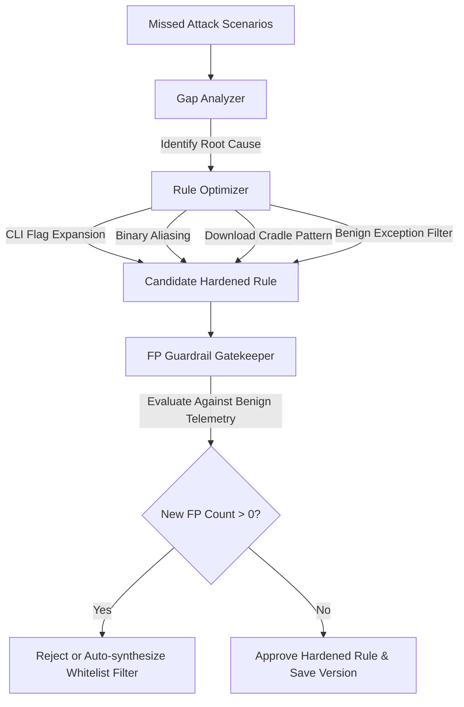

# RuleHardener System Architecture

## 1. System Overview
**RuleHardener** is an offline, deterministic cybersecurity platform engineered to evaluate Sigma detection rules against attack and benign telemetry datasets, identify detection blind spots, and propose hardened rule improvements while enforcing a strict **False-Positive Guardrail**.

---

## 2. Component Architecture

```
RuleHardener/
├── app.py                      # Multi-page Streamlit Dashboard
├── backend/
│   ├── config.py               # Paths, limits, and environmental configuration
│   ├── database.py             # SQLite persistence layer and CRUD models
│   ├── models.py               # Pydantic schemas (Rules, Telemetry, Scenarios, Metrics)
│   ├── rule_manager/
│   │   ├── sigma_loader.py     # Safe YAML loader and model converter
│   │   ├── sigma_validator.py  # Lexical and structural validator
│   │   └── rule_analyzer.py    # Target field and modifier inspector
│   ├── telemetry/
│   │   ├── event_normalizer.py # Normalizes Event 4688 / Sysmon 1 schemas
│   │   ├── synthetic_generator.py # Fixture generator for attacks and benign baselines
│   │   └── log_loader.py       # JSON/JSONL parser and schema validator
│   ├── detection/
│   │   ├── sigma_matcher.py    # Recursive-descent AST condition parser & modifiers
│   │   ├── detection_evaluator.py # Batch rule-to-event/scenario evaluation pipeline
│   │   └── metrics.py          # DR, FPR, Precision, Recall, F1 calculations
│   └── hardening/
│       ├── gap_analyzer.py     # Diagnoses root causes of missed attacks
│       ├── rule_optimizer.py   # Multi-strategy deterministic Sigma rule synthesizer
│       └── rule_comparator.py  # Side-by-side evaluation & FP Guardrail gatekeeper
```

---

## 3. Evaluation & AST Parsing Pipeline

Unlike typical converters that transpile Sigma into query languages (Elasticsearch, Splunk), RuleHardener implements a direct, deterministic in-memory evaluator:

1. **Selection Evaluation**:
   - Compares expected values against event attributes (`Image`, `CommandLine`, `ParentImage`, etc.).
   - Applies modifiers: `contains`, `startswith`, `endswith`, `re`, `windash` (equates `/` and `-`), and `all` (requires all list elements to match).
2. **Boolean AST Condition Evaluation**:
   - Lexes condition strings into tokens: `(`, `)`, `and`, `or`, `not`, identifiers, and quantifiers (`1 of selection*`, `all of them`).
   - Builds an Abstract Syntax Tree (AST) using recursive descent.
   - Evaluates boolean expressions against individual selection outcomes.

---

## 4. Deterministic Hardening & FP Guardrail Gatekeeper



1. **Gap Analysis**: Identifies why an attack was missed (e.g. parameter abbreviation `-enc` vs `EncodedCommand`, `pwsh.exe` vs `powershell.exe`, or unencoded download cradle).
2. **Rule Synthesis**: Generates valid updated Sigma YAML with expanded lists, secondary selections, and enterprise exclusion filters (`filter_sccm`).
3. **Guardrail Check**: Compares false positive rates. If candidate rule triggers on benign events, it is flagged/rejected, preventing SOC alert fatigue.

---

## 5. SQLite Data Model

- **`rules`**: Stores Sigma rule definitions, metadata, and current active version.
- **`rule_versions`**: Immutable version history for lineage and rollback.
- **`scenarios`**: Attack and benign test definitions with MITRE ATT&CK mapping.
- **`telemetry_events`**: Normalized process-creation events (Sysmon 1 / Security 4688).
- **`evaluation_runs`**: Historical test run scorecard.
- **`detection_results`**: Per-event matching and failure reasons.
- **`hardening_proposals`**: Proposed improvements, diffs, and guardrail verdicts.
- **`reports`**: Generated audit and compliance reports.
